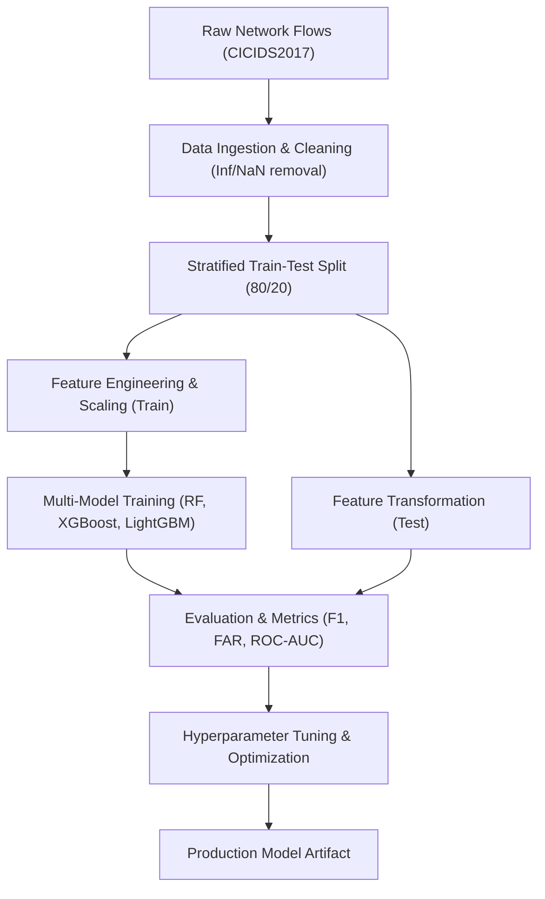

# Network Intrusion Detection System (NIDS) using Machine Learning

[](https://www.python.org/)
[](LICENSE)
[](#internship-roadmap)

An end-to-end, reproducible, production-grade Machine Learning-based Network Intrusion Detection System (NIDS) developed using the benchmark **CICIDS2017** dataset. This project follows an industry-aligned 6-week curriculum covering planning, exploratory data analysis, data preprocessing, model implementation, performance evaluation, hyperparameter optimization, and comprehensive reporting.

---

## 📌 Table of Contents
- [Executive Overview](#executive-overview)
- [System Architecture](#system-architecture)
- [Dataset Summary](#dataset-summary)
- [Repository Structure](#repository-structure)
- [Internship Roadmap (6 Weeks)](#internship-roadmap-6-weeks)
- [Installation & Quickstart](#installation--quickstart)
- [Running Pipeline & Tests](#running-pipeline--tests)
- [Tracking & Governance](#tracking--governance)

---

## Executive Overview
Modern enterprise networks face sophisticated cyber threats ranging from Distributed Denial of Service (DDoS) and botnets to subtle web application attacks and multi-stage infiltration. Signature-based intrusion detection systems (such as Snort or Suricata) struggle against zero-day exploits and polymorphic traffic patterns.

This project implements an anomaly and signature hybrid ML pipeline utilizing gradient boosted decision trees (XGBoost, LightGBM) and ensemble random forests capable of classifying network flows into 7 granular traffic categories with high detection rates and minimal false alarms.

---

## System Architecture



---

## Dataset Summary
The project utilizes the **CICIDS2017** benchmark dataset generated by the Canadian Institute for Cybersecurity (UNB):
- **Samples:** 56,661 representative bidirectional network flows.
- **Features:** 78 continuous/discrete network attributes extracted using `CICFlowMeter`.
- **Classes:**
  - `BENIGN` (Normal traffic - 40.12%)
  - `DoS` (Denial of Service - 33.59%)
  - `PortScan` (Port scanning / reconnaissance - 14.02%)
  - `BruteForce` (SSH / FTP brute force - 4.88%)
  - `WebAttack` (SQLi, XSS, Brute force - 3.85%)
  - `Bot` (Ares Botnet - 3.47%)
  - `Infiltration` (Multi-stage infiltration - 0.06%)

For exhaustive schema documentation, see [DATASET_INFO.md](DATASET_INFO.md).

---

## Repository Structure

```
├── .gitignore                      # Git ignore file
├── LICENSE                         # MIT License
├── README.md                       # Main project overview and documentation
├── requirements.txt                # Python package dependencies
├── PROJECT_STATE.md                # Living status and milestone tracker
├── RUN_LOG.md                      # Audit trail of pipeline and script runs
├── EXPERIMENT_LOG.md               # ML experiment tracking and benchmarks
├── DATASET_INFO.md                 # Dataset documentation and schema
├── data/
│   ├── raw/CICIDS2017/             # Raw dataset captures
│   ├── interim/                    # Cleaned, encoded, and balanced datasets
│   └── processed/                  # Split training and testing sets (X_train, X_test, ...)
├── notebooks/                      # Exploratory and prototyping Jupyter notebooks (01 to 07)
├── src/
│   ├── data/                       # Ingestion, cleaning, splitting, balancing
│   ├── features/                   # Encoding, scaling, selection
│   ├── models/                     # Training, tuning, inference
│   ├── evaluation/                 # Metrics, confusion matrix, error analysis
│   └── utils/                      # Logging, config management
├── models/
│   ├── baseline/                   # Serialized baseline models
│   ├── tuned/                      # Serialized optimized models
│   └── final/                      # Production model weights and scaler
├── results/
│   ├── metrics/                    # Quantitative evaluation metrics CSVs
│   ├── confusion_matrices/         # Confusion matrix plots and raw tables
│   ├── feature_importance/         # Feature ranking charts
│   └── plots/                      # Performance curve plots
├── reports/                        # Weekly deliverables and formal documentation (Weeks 1-6)
└── tests/                          # Automated pytest validation suite
```

---

## Internship Roadmap (6 Weeks)

- **Week 1: Project Planning & Setup**
  - Problem definition, environment configuration, literature review, architecture design, and timeline.
- **Week 2: Data Preprocessing & EDA**
  - Cleaning (inf/NaN handling), encoding, outlier analysis, feature distribution analysis, and class imbalance mitigation.
- **Week 3: Model Implementation (Baseline)**
  - Building baseline models: Logistic Regression, Decision Tree, Random Forest, XGBoost, LightGBM.
- **Week 4: Model Evaluation & Diagnostics**
  - Multi-class confusion matrices, precision/recall per class, ROC curves, cross-validation, and error analysis.
- **Week 5: Optimization & Hyperparameter Tuning**
  - Feature selection, hyperparameter tuning (GridSearchCV / Optuna), ensemble methods, inference latency benchmarks.
- **Week 6: Final Deliverables & Quality Audit**
  - Comprehensive internship report (PDF/Word), presentation slide deck, production pipeline verification, and poster.

---

## Installation & Quickstart

```bash
# 1. Clone repository
git clone <repo-url>
cd Network_instrusion_Detection_system

# 2. Create and activate virtual environment
python -m venv .venv
.\.venv\Scripts\Activate.ps1    # On Windows PowerShell

# 3. Install dependencies
pip install -r requirements.txt
```

---

## Running Pipeline & Tests

```bash
# Execute automated test suite
pytest tests/ -v
```

---

## Tracking & Governance
- Current project state: [PROJECT_STATE.md](PROJECT_STATE.md)
- Complete execution history: [RUN_LOG.md](RUN_LOG.md)
- Experiment results: [EXPERIMENT_LOG.md](EXPERIMENT_LOG.md)
